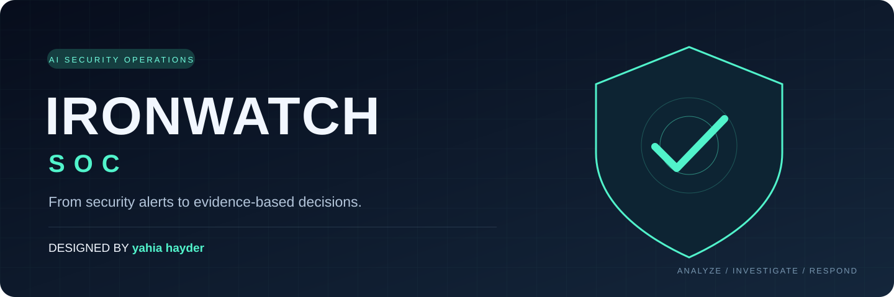
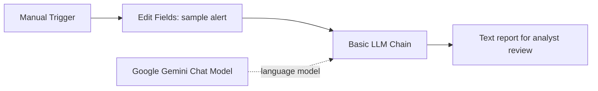

# IRONWATCH SOC

**From security alerts to evidence-based decisions.**

[Quick start](#quick-start) آ· [Architecture](#architecture) آ· [Example report](examples/sample-analysis.md) آ· [Roadmap](docs/future-roadmap.md)

---

**AI-assisted security alert analysis ط¢آ· Designed and maintained by yahia hayder**

IRONWATCH SOC is an n8n workflow that sends a sample security alert to Google Gemini and requests an evidence-based incident analysis. It separates supplied details from assumptions, suggests MITRE ATT&CK mappings, and recommends investigation and containment steps for human review.

> Status: educational prototype. Output is generated text, not validated JSON. Live SIEM ingestion, threat-intelligence enrichment, and automatic containment are not implemented.

## Quick start

1. Open an n8n instance with Basic LLM Chain and Google Gemini Chat Model nodes available.
2. Import [workflow/IRONWATCH-SOC.json](workflow/IRONWATCH-SOC.json).
3. Configure your own Gemini credential in **Google Gemini Chat Model**.
4. Select a model available to your account; the export does not pin one.
5. Edit the six sample alert fields in **Edit Fields**.
6. Execute manually and inspect **Basic LLM Chain** output.

See the [installation guide](docs/installation.md) and [troubleshooting guide](docs/troubleshooting.md). No API key is included. This revision has been checked locally; a live Gemini run requires your service access and credentials.

## Included capabilities

- Editable sample alert: `alertName`, `sourceIP`, `destinationHost`, `username`, `severity`, `description`.
- Evidence-oriented prompt with ten report sections.
- Suggested ATT&CK mappings, investigation pivots, and response recommendations.
- Qualitative confidence (Low / Medium / High) and risk ratings, not calibrated probabilities.
- Synthetic sample input and an illustrative report.

## Architecture

Gemini is attached to the chain as its model provider. Containment is recommended, never executed.

## Files and documentation

| File | Purpose |
| --- | --- |
| [Workflow](workflow/IRONWATCH-SOC.json) | Importable n8n export |
| [Prompt](prompts/soc-analyst-prompt.md) | Prompt mirrored in the workflow |
| [Sample alert](examples/sample-alert.json) | Machine-readable synthetic input |
| [Sample report](examples/sample-analysis.md) | Illustrative analysis, not a verified live run |
| [Architecture](docs/architecture.md) | Components and data flow |
| [Project review](docs/project-review.md) | Findings and remaining gaps |
| [Roadmap](docs/future-roadmap.md) | Planned improvements |
| [Visual identity](images/README.md) | Project cover and screenshot guidance |

## Limitations

Input validation, a validated output schema, retry/failure handling, regression checks, and deployment/version documentation remain to be implemented. SIEM ingestion, enrichment, deduplication, and report storage are future work.

Alert fields are sent to the configured Google service. Use synthetic or approved sanitized data. Prompt instructions reduce some risks but do not guarantee safe or accurate model output; analysts must verify conclusions. Alert IPs, hosts, and usernames are investigation pivots, not proof of compromise.

## Design and maintenance

**yahia hayder** أ¢â‚¬â€‌ IRONWATCH SOC project identity, documentation, and modifications.

MIT licensed. See [Contributing](CONTRIBUTING.md), [Security](SECURITY.md), and [Changelog](CHANGELOG.md).
